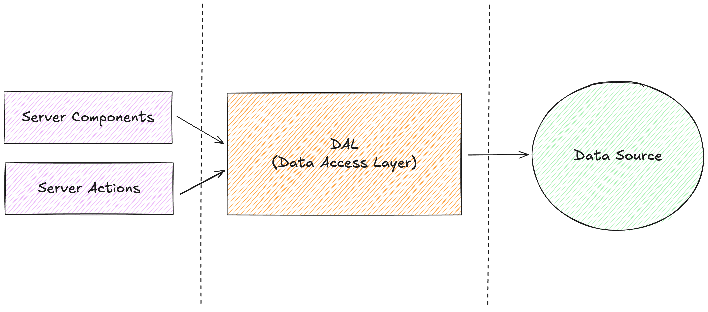

# React Server Components & Auth

**Kenta Kudo** - Freelance Software Engineer
React Osaka - June 2025

<!--
Hey everyone, I’m Kenta.

Today I'm going to talk about RSC and auth, but before jumping in, let me quickly introduce myself.
-->

---

## About Me 👋

- Freelance software engineer (backend → frontend)
- Spent 6 years working in London
- Moved back to Japan / Tokyo → Kansai
- First time speaking at this meetup!

<!--
I’m a freelance software engineer—mostly backend, but I’ve been working on frontend lately too.

I spent about six years working in London, and moved back to Japan a couple of years ago.
I just relocated to Kansai a few months ago. Because I'm originally from Sendai, I'm very new to the area.
I joined this meetup last time, but this is my first time speaking—nice to officially say hi to the community.
-->

---

## Today's Agenda

1. **Why** do we need to rethink auth for RSC?
2. **When & Where** should auth happen?
3. **How** to implement it in practice?

<!--
Today I’ll be talking about auth in the context of React Server Components (RSC).

When I started learning RSC, I realised I didn’t fully understand how authentication and authorisation should work,
especially because of my lack of experience in server-side rendering. So I dug in—and I’ll walk you through what I learned.

Here’s a quick agenda:
- First: Why do we even need to rethink auth for RSC?
- Then: When and where should it happen?
- Finally: What does it look like in actual code?

Let’s jump in.
-->

---

# Why Rethink Auth with RSC?

<!--
We all know auth is critical. We don’t want random users accessing protected data. That’s obvious.
But with RSC, things get a little trickier.
-->

---

## Auth Basics (Quick Refresher)

**Authentication (authN)** = Who is the user?
**Authorisation (authZ)** = What can they do?
**Access Control** = authN + authZ

<!--
Just a quick refresher:
- Authentication (authN) = confirming who the user is
- Authorization (authZ) = checking what they’re allowed to do
And these two combined is sometimes called access control.

Now let's check out how RSC changes the game.
-->

---

## The RSC Twist

> React Server Components **blur the boundary** between client and server.

— "How to Think About Security in Next.js" / Next.js team

What used to be clearly "backend" is now happening inside your frontend repo.

⚠️ **We need to update our mental model** of where auth should live—and how to keep it secure.

<!--
Now here’s the twist:

"React Server Components blur the boundary between client and server."
This is a quote from a blog post by Next.js team.

What used to be clearly backend is now happening inside React framework.
So we need to update our mental model of where auth should live and how to keep it secure.
-->

---

# When & Where Should Auth Happen?

<!--
So the next question is: when & where should auth happen?
-->

---

## When to Authorise?

**Simple answer:** Any time a user accesses protected data

In the RSC world:

- **Read access** → Inside server components
- **Write access** → Inside server actions

Both cases need authorization! 🔒

<!--
Simple answer is: any time a user accesses protected data — either reading or writing.

In the RSC world:
- Read access typically happens inside server components
  - you may read data from server action before writing
- Whereas write access should happen only inside server actions (and not in server components)

In both cases, you need to authorize.
-->

---

## Exception: different memory model (⇄ same memory model)

```ts
export default async function UserDashboard() {
  const session = await getSession();
  const response = await fetch('https://api.yourbackend.com/user/profile', {
    headers: {
      'Authorization': `Bearer ${session.idToken}`, // Call external API with ID token
      'Content-Type': 'application/json',
    },
  });

  ...
}
```

- ✅: Keep things separated, clean
- ❌: Too rigid, complex

<!--
But there’s a case where we (as frontend engineers) don’t worry too much; calling traditional backend APIs via HTTP.
Let me call it different memory model because assessing data directly from React framework is sometimes referred to as same memory model

You can pass an ID token, and the backend handles auth as usual.

That setup keeps things separate, which is clean, but sometimes too rigid.
It introduces team boundaries and extra complexity.

So today, I’ll focus only on same memory model; cases where we access data directly from inside React via server components or actions.
-->

---

## Where Should Auth Happen?

### 1. Server Components & Server Actions ⭐

**Main place** - authorize before reading/writing protected data

### 2. Route Handlers (Next.js)

Treat them like mini-APIs - auth required here too

### 3. Optional: Middleware (Next.js)

Route-level access checks

<!--
So the next question is where should it happen?
There are three surfaces on server process that take requests from client.

1. Inside Server Components / Server Actions
This is the main place. You should authorize before you read or write any protected data.

2. Route Handlers
In Next.js you can write server functions for things like form submission or file upload.
If you're using Route Handlers, treat them like mini-APIs. You need to authorize here too.

3. Optionally: Middleware
This is also Next.js only, and middleware runs before every server request.
You can use it for lightweight checks like route-level access.
-->

---

## Middleware: Be Careful! ⚠️

- Runs on **every request** → needs to be fast
- Edge runtime on Vercel → no full Node.js, no DB access
- **Use only for fast, optimistic checks**

<!--
But be careful: it's recommended to run only lightweight checks
- Because middleware runs on every request, it needs to be fast.
- On platforms like Vercel, it runs in an edge runtime — so not all Node.js APIs are supported, and you may not be able to access DB.

So: use middleware only for fast, optimistic checks, not deep auth logic.
-->

---

## Middleware: Be Careful! ⚠️

```ts
// middleware.ts
import { NextResponse } from "next/server";

// ✅ Good: Check if session cookie exists
export function middleware(request) {
  const hasSession = request.cookies.has("session");
  if (!hasSession) {
    return NextResponse.redirect(new URL("/login", request.url));
  }
}

// ❌ Bad: Query database for user permissions
export async function middleware(request) {
  const token = request.cookies.get("session")?.value;
  const user = await db.user.findUnique({
    where: { sessionToken: token },
  });
  if (!user) {
    return NextResponse.redirect(new URL("/login", request.url));
  }
}

export const config = {
  matcher: "/dashboard/:path*",
};
```

---

# How: Practical Implementation

<!--
Ok we now covered why, when & where we need authorisation.
The last topic is how it practically looks like in code.
-->

---

## Three Parts of Auth

1. **Authentication** - Confirm user identity
2. **Session Management** - Track logged-in users
3. **Authorisation** - Check resource access

<!--
There are three parts:
- Authentication: Confirm user identity (e.g. login form + password)
- Session management: Keep track of logged-in users
- Authorization: Check if user is allowed to access a given resource

I'm not going to cover how to implement login form and handle login requests.
-->

---

## Session Management

**Session stores:**

- User ID, roles/permissions, expiration
- Maybe other metadata

**Two approaches:**

- **Cookie-based** - All data in secure HTTP-only cookie
- **DB-based** - Session in DB, client gets session ID

Use trusted libraries: **auth.js** (fka next-auth), **Auth0** 🛡️

<!--
Once authenticated, you create a session. It usually contains:
- user ID
- roles or permissions
- expiration timestamp
- maybe other metadata

There are two main ways to store session data:
- Cookie-based: Store all session info in a secure HTTP-only cookie
- DB-based: Store session in the DB, and give the client just a session ID
    - (Even for DB-based you use cookie to pass session id back to client)

DB-based is more secure but adds some complexity.
Either way, make sure cookies are secure and HTTP-only to prevent malicious attacks such as CSRF attach.

To implement authentication and session management correctly, it's recommended to use trusted libraries like auth.js (formerly next-auth) or Auth0 so you’re not reinventing session handling.
-->

## Authorisation — How to structure your code

```ts
const user = await db.user.findUnique({ where: { id } });
```

❌ **Security risk** - Easy to forget auth checks
❌ **Inconsistent patterns** - Auth logic scattered everywhere
❌ **Hard to maintain** - Security mixed with UI code

<!--
The last piece is authorisation. And for it let’s talk about how to structure your code.

Of course you can access data directly from server components like this.

But there are a couple of issues doing so:
- Firstly, it
- Secondly, ...
- And finally, ...
-->

---

## The DAL Pattern ⭐

**Data Access Layer** - Next.js team recommendation



<!--
The Next.js team recommends creating a layer between server components and data that handles data access calling it Data Access Layer (DAL).
-->

---

## Why Use a DAL?

✅ Isolate auth checks and data access
✅ Easier to audit and reuse
✅ Keep server components clean
✅ Consistent security patterns

<!--
By adding layer structure and having layer that is responsible for data access:
- you can isolate where auth checks and data access happen,
- it’s easier to audit and reuse, and
- it keeps your server components clean
-->

---

## DAL Example

```ts
// some-server-component.tsx
import { getUser } from "dal.ts";
const SomeServerComponent = () => {
  const user = await getUser();
  ...
}
```

```ts
// dal.ts
export const getUser = async () => {
  const session = await verifySession();
  if (!session) throw new Error("Unauthorized");
  const user = await db.user.findUnique({
    where: { id: session.userId },
  });
  return { id: user.publicId };
};
```

<!--
Here's an example of DAL pattern:
- In your server component, don’t access the DB directly
- Instead, call a method like getUser() from dal.ts
- Inside that DAL method, verify the session first
- Once session is verified, fetch the data and return it back to the component

By structuring data access like this, you can make sure no matter where user data is retrieved it's authorised.
-->

---

## Tips for better DAL

<!--
There are few tricks to make DAL better.

Sometimes you want to access different types of resource in a single rendering.
For example retrieving user data and the documents data the user created.
Because verifySession() is called inside the DAL methods, it's called every time DAL methods are called, and it can be expensive depending on your auth implementation.

How should we work it around?
-->

---

## The Magic of cache() 🎩

```ts
import { cache } from "react";

export const verifySession = cache(async () => {
  // verify session...
  return { isAdmin: true, userId: session.userId };
});

export const getUser = cache(async () => {
  const session = await verifySession();
  // fetch data...
});
export const getDocuments = cache(async () => {
  const session = await verifySession(); // Only runs once per request!
  // fetch data...
});
```

- Caches result during single render cycle → No extra session checks
- Per-request only → safe from data leaks

<!--
To fix that, wrap your DAL methods with React’s cache():

This caches the result during a single render cycle—no extra session checks. It’s per-request, so it’s safe.

Another concern is what if DAL files are imported in client component accidentally?
-->

---

## Keep It Server-Only

```ts
// Add this to every DAL file
import "server-only";
```

**Throws build error** if imported in client component

<!--
We don't want DAL files to be sent to client browser.

React team provides a nice npm package called 'server-only'.
Once it's imported, it throws a build error if that file itself is imported from a client component.

So that's a nice safeguard.
-->

---

## DTO Pattern for Safety

```ts
// ❌ Don't return raw DB data
return user; // includes password hash, internal IDs

// ✅ Return safe DTO
return {
  id: user.publicId,
  name: user.name,
  email: user.email,
};
```

→ Just like you would from an API 📡

<!--
Also, to avoid accidentally leaking sensitive data to the client:
- We can define a dedicated data model that can be sent to client
- It's called DTOs (Data Transfer Objects)
- It's instantiated in the DAL and sent back to the caller to make sure
- To return only safe, structured data—just like you would from an API
-->

---

# Wrap-up

<!--
This is the end of my talk today
So let me wrap it up
-->

---

## Main Points to Remember

- RSC changes the structure—not the need—for auth
- Authorize in server components, actions, route handlers
- Middleware is optional, use carefully
- DAL helps manage complexity
- Use trusted libraries for session handling

---

## Thanks for listening!

### References:

- **[Next.js documentation on authentication](https://nextjs.org/docs/app/guides/authentication)**
  - highly recommend diving deeper there
- **[How to Think About Security in Next.js](https://nextjs.org/blog/security-nextjs-server-components-actions)**

<!--
That's all from me today!

I hope this helps you think about auth in RSC projects—and maybe saves you from some of the confusion I had when I first started.

This talk is heavily inspired by Next.js documentation on authentication. So please check it out if you haven't.

Thanks for listening!

I'd love to take any questions you might have.
-->
