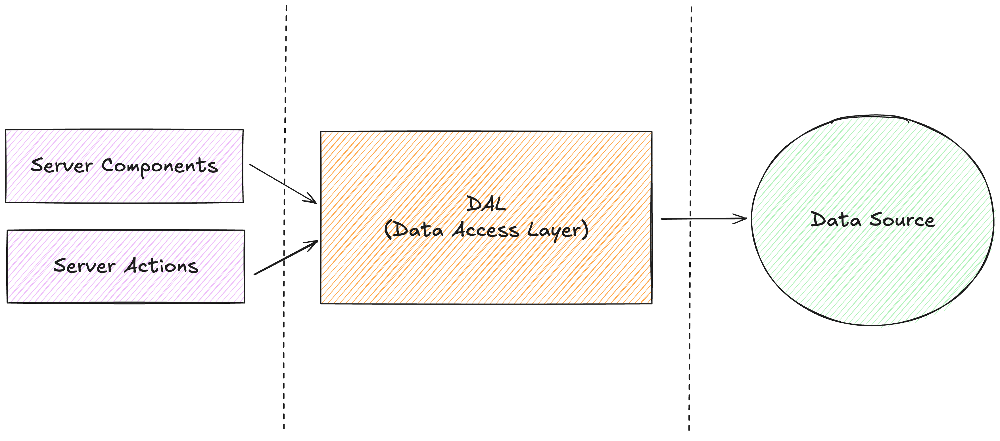

# React Server Components & Auth

**Kenta Kudo** - Freelance Software Engineer
React Osaka - June 2025

<!--
Hi everyone, I'm Kenta.

Today I'm going to talk about RSC and auth.

Quick note on format - I'll be presenting in English, but the slides are in Japanese.
Please feel free to jump in with questions anytime, in either language.
And if you want to chat more after the talk, definitely come find me.

発表は英語で行いますが、スライドは日本語にしています。
もしわからないことがあればもちろん日本語でも構わないので、トーク中でも発表後でもいつでもお気軽に声をかけてください。

So let me start with a quick intro about myself.
-->

---

## 自己紹介 👋

- フリーランスソフトウェアエンジニア（バックエンド → フロントエンド）
- 🇬🇧 ロンドンで 6 年間勤務
- 日本に帰国 / 東京 → 関西
- React Osaka 初登壇！

<!--
I'm Kenta. I'm a freelance software engineer.

I started out doing mostly backend work, but these days I'm focusing more on frontend development.
I spent about six years working in London before moving back to Japan a couple of years ago.
Initially I was in Tokyo, but I relocated to the Kansai area just a few months ago.
Since I'm originally from Sendai, this region is still pretty new to me.
I actually attended this meetup last time, but this is my first time presenting here, so it's nice to officially say hi to the community.
-->

---

## 今日のアジェンダ

1. WHY: **なぜ** RSC で認証を再考する必要があるのか？
2. WHEN and WHERE: **いつ・どこで** 認証を行うべきか？
3. HOW: **どのように** 実装するのか？

<!--
Today I'll be talking about auth in the context of React Server Components (RSC).

When I started learning RSC, I realised I didn't fully understand how authentication and authorisation should work.
So I dug in—and I'll walk you through what I learned.

Here's a quick agenda:

- First, we'll explore why RSC changes the auth game
- Next, we'll dive into the timing and placement of auth
- Finally, we'll get hands-on with implementation

Let's get started with why RSC requires us to rethink auth.
-->

---

# WHY: なぜ RSC で認証を再考するのか？

<!--
We all know auth is critical. We don't want random users accessing protected data. That's obvious.
But with RSC, things get a little trickier.
-->

---

## 認証について

**認証（Authentication, authN）** = ユーザーは誰か？
**認可（Authorization, authZ）** = 何ができるか？
**アクセス制御** = 認証 + 認可

<!--
Just a quick refresher:
- Authentication = confirming who the user is
- Authorization = checking what they're allowed to do
And these two combined is sometimes called access control.

In this talk I'm going to use the word auth to cover both authN and authZ.

Now let's check out how RSC changes the game.
-->

---

## RSC の新展開

> React Server Components は**クライアントとサーバーの境界を曖昧にする**。

— "How to Think About Security in Next.js" / Next.js チーム

以前は明確に「バックエンド」だったものが、今はフロントエンドのリポジトリ内で起こる

⚠️ **認証がどこに存在すべきか、どのように安全に保つかについて、メンタルモデルを更新する必要がある**。

<!--
Now here's the twist:

"React Server Components blur the boundary between client and server."
This is a quote from a blog post by Next.js team.

What used to be clearly backend is now happening inside React framework.
So we need to update our mental model of where auth should live and how to keep it secure.
-->

---

# WHEN and WHERE: いつ・どこで認証を行うべきか？

<!--
So the next question is: when & where should auth happen?
-->

---

## いつ認可すべきか？

**シンプルな答え：** ユーザーが保護されたデータにアクセスするたび

RSC の世界では：

- **読み取りアクセス** → (主に)サーバーコンポーネント内
- **書き込みアクセス** → サーバーアクション内

どちらの場合も認可が必要 🔒

<!--
So the simple answer is: every single time a user tries to access protected data - whether it's reading or writing.

Now, in the RSC world, when we're talking about read access, that's typically happening inside your server components.
It can also happen in server actions too - like when you need to read some data before you actually write it.

Write access, on the other hand, should only be happening inside server actions - not in your server components.

The key thing to remember is that in both of these cases, you absolutely need to authorise.
-->

---

## 例外：異なるメモリモデル（⇄ 同じメモリモデル）

```ts
export default async function UserDashboard() {
  const session = await getSession();
  const response = await fetch('https://api.yourbackend.com/user/profile', {
    headers: {
      'Authorization': `Bearer ${session.idToken}`, // IDトークンで外部APIを呼び出し
      'Content-Type': 'application/json',
    },
  });

  ...
}
```

- ✅: 分離されてクリーン
- ❌: 硬直的で複雑

<!--
But there's a case where we (as frontend engineers) don't worry too much; calling traditional backend APIs via HTTP.
Let me call it different memory model because assessing data directly from React framework is sometimes referred to as same memory model

You can pass an ID token when you call API with fetch() function like this, and the backend handles auth as usual.

That setup keeps things separate and clean, but sometimes it feels overkill — especially if you're working on a small team or just getting a project off the ground as it introduces team boundaries and extra complexity.

So today, I'll focus only on same memory model where we access data directly from inside React ...but where exactly should it be?
-->

---

## どこで認証を行うべきか？

### 1. サーバーコンポーネント & サーバーアクション ⭐

**メインの場所** - 保護されたデータの読み取り/書き込み前に認可

### 2. ルートハンドラー（Next.js）

ミニ API として扱う - ここでも認証が必要

### 3. オプション：ミドルウェア（Next.js）

ルートレベルのアクセスチェック

<!--
Well, there are three main places in your server-side code where users can access data.

1. Inside Server Components / Server Actions
This is the main place. You should authorize before you read or write any protected data.

2. Route Handlers
In Next.js you can write server functions for things like form submission or file upload.
If you're using Route Handlers, treat them like mini-APIs. You need to authorize here as well.

3. Optionally: Middleware
This is also Next.js only, and middleware runs before every server request.
You can use it for lightweight checks like route-level access.
-->

---

## 注意 ⚠️：ミドルウェア

- **すべてのリクエスト**で実行される → 高速である必要がある
- Vercel の Edge ランタイム → 完全な Node.js なし、DB アクセスなし

→ **高速で楽観的なチェックのみに使用**

<!--
Now, I mentioned middleware is for lightweight checks - by that I mean to keep it fast and simple.

Two reasons:
- First, middleware runs on every single request to your app, so if it's slow, your entire app becomes slow.
- Second, on platforms like Vercel, middleware runs in what's called an edge runtime.
  - This means you don't have access to the full Node.js API, and you might not be able to verify session.

So the bottom line is: use middleware only for quick, surface-level checks - not for complex auth logic.
-->

---

## 注意 ⚠️：ミドルウェア

```ts
// middleware.ts
import { NextResponse } from "next/server";

// ✅ 良い例：セッションクッキーの存在をチェック
export function middleware(request) {
  const hasSession = request.cookies.has("session");
  if (!hasSession) {
    return NextResponse.redirect(new URL("/login", request.url));
  }
}

export const config = {
  matcher: "/dashboard/:path*",
};
```

<!--
This is a good example of middleware.

All it does is check: "Does this request have a session cookie?" If not, redirect to login.
This is super fast because we're just looking at the cookie - it doesn't even verify it.

Now, the check isn't enough - the cookie could be expired or invalid.
But that's okay! We'll do the real verification later in our server components.

This is just a first line of defence.
-->

---

## 注意 ⚠️：ミドルウェア

```ts
// middleware.ts
import { NextResponse } from "next/server";

// ❌ 悪い例：ユーザー権限のためにデータベースをクエリ
export async function middleware(request) {
  const token = request.cookies.get("session")?.value;
  const user = await db.user.findUnique({
    where: { sessionToken: token },
  });
  if (!user) {
    return NextResponse.redirect(new URL("/login", request.url));
  }
}

export const config = {
  matcher: "/dashboard/:path*",
};
```

<!--
The second example here shows what NOT to do.

Here we're trying to verify the session token and query the database for user information.
This will be slow, and worse - it might not even work on the runtime you use.

So remember: keep middleware simple and fast, like the first example.

---

Alright, before we dive into the practical implementation details, any questions about what we've covered so far?
Please stop me if you have any questions; otherwise I hope we have some time for questions after the talk.
-->

---

# HOW：実装

<!--
Ok, we now covered why, when & where we need auth.
Now let's dive into the practical side - how does this actually look in code?

Before we jump into RSC specifics, let's first understand the fundamental building blocks that make up any auth system.
-->

---

## 認証の 3 つの要素

1. **認証** - ユーザーの身元確認
2. **セッション管理** - ログインユーザーの追跡
3. **認可** - リソースアクセスの確認

<!--
Every auth system, whether it's traditional client-side or with RSC, is built on these three core components:

- Authentication: This is about confirming user identity - think login forms and password verification
- Session management: Once authenticated, we need to keep track of who's logged in
- Authorization: Finally, we check if that authenticated user can access specific resources

I won't spend time on basic login forms today - you probably know how to handle those.
Let's focus on the parts that matter for RSC, starting with session management.
-->

---

## セッション管理

**セッション情報：**

- ユーザー ID、ロール/権限、有効期限
- その他のメタデータ

**2 つのアプローチ：**

- **クッキーベース** - 安全な HTTP-only クッキーにすべてのデータ
- **DB ベース** - セッションを DB に、クッキーでセッション ID を送信

**セキュリティ対策：**

- `secure`, `HttpOnly`, `SameSite=Strict` (or `Lax`) 属性を設定
- CSRF、XSS 攻撃の影響を軽減

→ 信頼できるライブラリを使用：**auth.js**（旧 next-auth）、**Auth0** 🛡️

<!--
Once you know who the user is, you create a session that tracks the user's login state.

Session data typically includes: user ID, roles/permissions, expiration time, and any relevant metadata.

To store these information, you have two main approaches:
- Cookie-based stores everything in a cookie - simple but has size limitations.
- DB-based stores session data on the server and sends only a session ID via cookie - more secure and scalable, but adds complexity.

For both cases, always use secure, HttpOnly, and SameSite attributes on cookies to mitigate XSS and CSRF attacks.

Because this is complex to get right, it's recommended to use proven libraries like auth.js (formerly next-auth) or Auth0.

Now let's move on to the final piece - authorization.
-->

---

## 認可 — コードの構造化

```ts
const SomeServerComponent = () => {
  const session = await verifySession();
  if (!session) throw new Error("Unauthorized");
  const user = await db.user.findUnique({ where: { id } });
  ...
}
```

❌ **セキュリティリスク** - 認可チェックを忘れやすい
❌ **一貫性のないパターン** - 認証ロジックがあちこちに散らばる
❌ **保守が困難** - セキュリティと UI ロジックが混在

<!--
It's natural to handle auth directly in your components like this.

Now this might look reasonable at first glance - we're checking the session, throwing an error if unauthorized, then fetching data.

But this approach has some problems:
- First, it's easy to forget authorization checks
- Second, there's no consistent place to handle auth logic - every component needs to repeat this pattern
- And finally, it's hard to audit and maintain - your security logic is now scattered across every component.

So what's the solution?
The Next.js team recommends creating a Data Access Layer - or DAL - that sits between your components and your data source.
-->

---

## DAL パターン ⭐

**Data Access Layer (データアクセス層)** - Next.js チームの推奨



<!--
As you can see in this diagram, instead of your server components and server actions directly accessing your datastore, they go through this DAL layer first.

The DAL handles the actual data access and authorization logic.

This creates a clear separation of concerns - your server components and actions can focus on UI and business logic, while the DAL centralizes all data access and security.
-->

---

## なぜ DAL を使うのか？

✅ 認証チェックとデータアクセスを分離
✅ 監査と再利用が容易
✅ サーバーコンポーネントをクリーンに保つ
✅ 一貫したセキュリティパターン

→ チーム間での分担も可能に 🤝

<!--
The DAL pattern gives you several benefits:

- First, you separate security from UI logic.
- Second, it's easier to audit and reuse your data functions.
- Third, your components stay clean and focus on presentation.
- And, you get consistent security across your entire app.

Plus, this separation makes it possible for different teams to work independently - one team owns the DAL, others build components that use it.
-->

---

## DAL の例

```ts
// some-server-component.tsx
import { getUser } from "dal.ts";
const SomeServerComponent = () => {
  const user = await getUser();
  ...
}
```

```ts
// dal.ts
export const getUser = async () => {
  const session = await verifySession();
  if (!session) throw new Error("Unauthorized");
  const user = await db.user.findUnique({
    where: { id: session.userId },
  });
  return { id: user.publicId };
};
```

<!--
Let me walk you through this DAL pattern example:

On the server component side, we've moved away from direct database access.

Instead, components now interact with the DAL layer by importing and calling methods like getUser().

This approach keeps our components clean and focused purely on UI logic, completely separating them from data access concerns.

Looking at the DAL implementation, each method serves as a comprehensive handler for both authorization and data fetching.

The process begins with session verification - if the user isn't authorized, we immediately throw an error.
Only after confirming authorization do we proceed with the actual data fetch.
Finally, we return the fetched data back to the component.

This pattern creates a robust security boundary while maintaining clean code organization.

Let's look at some tips to make this pattern even more powerful...
-->

---

## Tips 1. cache()の魔法 🎩

```ts
export const verifySession = async () => {
  // セッションを検証...
  return { isAdmin: true, userId: session.userId };
};

export const getUser = async () => {
  const session = await verifySession();
  // データを取得...
};
export const getDocuments = async () => {
  const session = await verifySession(); // ❌ セッションを再び検証
  // データを取得...
};
```

<!--
When building a server component, you might need to fetch multiple resources in a single render.
For example, you might need both user data and their documents.

The issue arises because each DAL method independently calls verifySession().
First in getUser() and again in getDocuments().

This means we're performing the same expensive session verification multiple times within a single render cycle.
Depending on your authentication implementation, this can significantly impact performance.

The solution is to use React's cache() function...
-->

---

## Tips 1. cache()の魔法 🎩

```ts
import { cache } from "react";
export const verifySession = cache(async () => {
  // セッションを検証...
  return { isAdmin: true, userId: session.userId };
});
export const getUser = async () => {
  const session = await verifySession();
  // データを取得...
};
export const getDocuments = async () => {
  const session = await verifySession(); // ✅ リクエストごとに1回のみ実行！
  // データを取得...
};
```

- 単一のレンダリングサイクル中に結果をキャッシュ → 余分なセッションチェックなし
- リクエストごとのみ → データ漏洩の心配はない

<!--
By wrapping verifySession() with cache(), the result of the function is memoized during the entire render cycle so that the session verification happens only once even if multiple DAL methods call it.

You may wonder if it's okay to cache authentication result.
Don't worry about it — the cache is request-scoped meaning each new request gets its own fresh cache, preventing sharing any data between users.

---

Another concern is what if DAL files are imported in client component accidentally?
-->

---

## Tips 2. サーバー専用を保つ

```ts
// すべてのDALファイルにこれを追加
import "server-only";
```

クライアントコンポーネントでインポートされた場合、**ビルドエラーを発生**

<!--
Our DAL files contain sensitive operations like database queries and authorization logic - we definitely don't want these sent to the client browser.

The React team provides a helpful npm package called 'server-only' to prevent exactly this issue.

How to do it?
Simply import the package in all your DAL files like this.
Once imported, it throws an error at build time if that file is ever imported from a client component.

This acts as a crucial safeguard, ensuring our data access layer remains server-side only.
-->

---

## Tips 3. 安全性のための DTO パターン

```ts
// ❌ 生のDBデータを返さない
return user; // パスワードハッシュ、内部IDを含む

// ✅ 安全なDTOを返す
return {
  id: user.publicId,
  name: user.name,
  email: user.email,
};
```

→ API から返すのと同じように 📡

<!--
Our final tip addresses another security concern; accidentally leaking sensitive data like password hashes to the client.

The solution is to use DTOs - Data Transfer Objects.
These are dedicated data models that define exactly what can be safely sent to the client.

Create your DTOs in the DAL layer and return only the safe, structured data your components actually need.
Think of it just like defining a backend API response - you're being intentional about what crosses the server-client boundary.

This pattern gives you explicit control over data exposure and helps prevent accidental data leaks.
-->

---

# まとめ

<!--
This is the end of my talk today
So let me wrap it up
-->

---

## 覚えておくべき要点

- RSC は認証の必要性ではなく構造を変える
- サーバーコンポーネント、アクション、ルートハンドラーで認可
- ミドルウェアはオプション、慎重に使用
- DAL は複雑さの管理に役立つ
- セッション処理には信頼できるライブラリを使用

<!--
- RSC changes the structure — not the need — for auth
- Authorize in server components, actions, route handlers
- Middleware is optional, use carefully
- DAL pattern helps manage complexity
- Use trusted libraries for session handling
-->

---

## Thanks for listening!

### 参考資料：

- **[Next.js 認証に関するドキュメント](https://nextjs.org/docs/app/guides/authentication)**
  - より深く掘り下げることを強く推奨
- **[How to Think About Security in Next.js](https://nextjs.org/blog/security-nextjs-server-components-actions)**

<!--
That's all from me today!

I hope this helps you think about auth in RSC projects — and maybe saves you from some of the confusion I had when I first started.

This talk is heavily inspired by Next.js documentation on authentication. So please check it out if you haven't.

Thanks for listening!

I'd love to take any questions you might have.
-->
